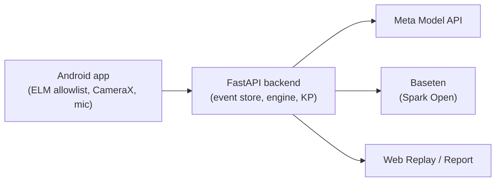

# Master Mechanic Copilot

A master mechanic in your pocket that shows its work. Live OBD2 data, the phone camera and your voice feed a
deterministic Bayesian diagnostic engine that ranks the next best test for your skill and tools, explains why each
suspect rose or fell, and produces a hash-chained, replayable report.

Built for the Meta AI Developer Hackathon (Indie track). Muse Code wrote the code from `AGENTS.md`/`docs/SPEC.md`
during the event, driven headlessly with plans and reviews on `muse-wonder-1.0` and builds on `muse-spark-1.3`
(prompts and runs are in `.agents/`).



## Meta model map

| Model | ID | Role |
|---|---|---|
| Spark | `muse-spark-1.3` | Reasoning, vision reads, PDF extraction |
| SAM | `sam-3.1` | Segmentation masks |
| Voice Transcribe | `muse-voice-transcribe-1.0` | Speech-to-text only (Android TTS speaks) |
| Wonder | `muse-wonder-1.0` | One review per report |
| Spark Open | `meta-models/muse-spark-open-1026` via Baseten | Second opinion / fallback (own $80 ledger) |
| Muse Code | — | Builds the repo |

Muse Image is explicitly excluded from the diagnostic path: no generated image is ever used as evidence.

## Run the simulator / replay locally

```sh
cd backend && uv run pytest -q
scripts/replay_check.sh backend/tests/fixtures/sessions/*.mmrec
cd web && npm ci && npm run build
```

`scripts/dev.sh` boots the backend + web. The simulator needs no car and no keys; replay costs $0
(`REPLAY_USE_CACHED_LLM=true` replays recorded AI outputs without live calls).

## Public demo

Deployed Modal app: <https://jeremydoege89--mmc-fastapi-app.us-east.modal.run> — open with `?judge=1` for the
60-second judge path (`docs/JUDGES.md`).

## Safety

Read-only OBD: the ELM driver allowlists services `01, 02, 03, 05, 06, 07, 09, 0A`, plus Mode 22 only when the
adapter profile enables it and the DID is allowlisted, and Mode 04 only via a single-use ClearToken from the gated
clear-codes flow (which explains the readiness-monitor reset). Blocked always: `10, 11, 14, 27, 28, 2E, 2F, 31, 34,
35, 36, 37, 3D, 85`. Safety-gated tests show a checklist first and stay unrunnable until acknowledged; some findings
stop the session with a see-a-professional banner. These gates are code, not prompts.

## Prior experience

The author has prior hands-on experience with OBD2/CAN diagnostics and Android development. No code from earlier
projects is included; everything in this repository was written during the event.

## Docs

- `AGENTS.md`: build rules, schemas, API contracts and milestones (what Muse Code follows)
- `docs/SPEC.md`: product and engineering spec
- `docs/PLAN.md`: schedule and checklist
- `docs/RULES.md`: hackathon rules status
- `docs/DECISIONS.md`: decision log
- `docs/JUDGES.md`: 60-second judge path
- `docs/RELEASE.md`: signed release build (owner-run)
- `docs/SAFETY.md`: on-vehicle checklist

## Licence

Licence: TBD by owner
